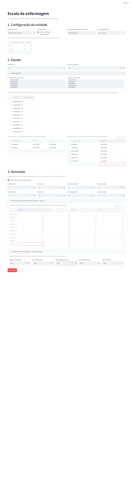
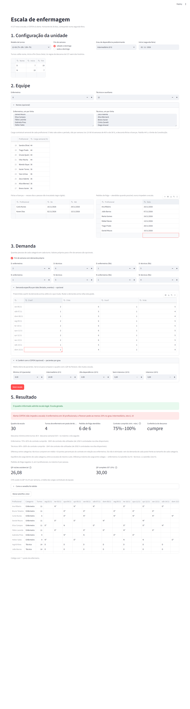
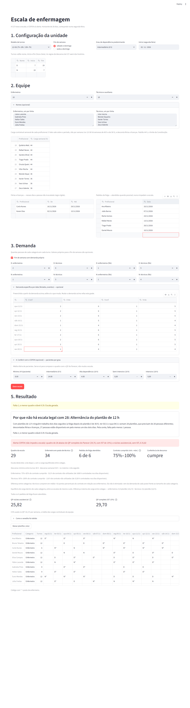

# Guia de uso — Escala de enfermagem

Este guia é para quem vai **usar** a ferramenta: enfermeira coordenadora, gestor de unidade,
quem monta a escala do mês. Não precisa saber programar.

---

## 1. O que a ferramenta faz

Você informa a unidade, a equipe e quantas pessoas precisa em cada turno. A ferramenta
devolve:

- **se a equipe dá conta** de uma escala que cumpre as regras de descanso da CLT;
- **a escala** de 28 dias, para baixar em planilha (.xlsx);
- **se não dá conta**, o motivo e o **menor quadro** com que daria;
- **alertas do COFEN** (Parecer Normativo nº 1/2024): proporção de enfermeiros e quadro de
  pessoal. Os alertas só avisam; não impedem a escala;
- **alerta de descanso semanal** abaixo de 35 h (Súmula 110 do TST). Também só avisa.

Entre todas as escalas legais, ela escolhe esta, nesta ordem:

1. a que atende o maior número de pedidos de folga;
2. a que põe menos enfermeiros cobrindo posto de técnico;
3. a que divide a carga de forma mais parecida entre colegas da mesma categoria.

As regras que **nunca** são quebradas:

- descanso entre turnos;
- descanso semanal;
- dias seguidos de trabalho;
- carga contratual de cada pessoa;
- férias e licenças.

## 2. O que a ferramenta **não** faz

- Não refaz a escala durante o mês por causa de faltas ou mudança de demanda.
- Não trata mais de uma unidade ao mesmo tempo, nem turnos partidos.
- Não calcula férias, ausências (IST), educação permanente nem enfermeiros gerenciais. Ela
  mostra o quadro da fórmula do COFEN, mas a escala cobre só a assistência.
- Não gera escala por mês civil: são sempre **28 dias, começando numa segunda-feira**.
- Não calcula custo de pessoal nem se liga a ponto eletrônico ou folha de pagamento.
- Quando a equipe não basta, não mostra onde faltaria gente. Ela informa só o menor quadro
  com que a escala fecha.
- Não trata habilidades além de enfermeiro e técnico.
- Não confere a virada de um período para o seguinte. Cada escala de 28 dias é feita
  sozinha.
- Não afirma conformidade jurídica. Os parâmetros do COFEN entram como valores declarados.

---

## 3. Como instalar no Windows

Você faz isto **uma vez só**.

**Passo 1 — Instale o Python.**
1. Entre em <https://www.python.org/downloads/> e baixe o Python 3.11 ou mais novo.
2. Na primeira tela do instalador, **marque "Add python.exe to PATH"** e clique em
   "Install Now".

**Passo 2 — Baixe a ferramenta.**
1. Entre em <https://github.com/otacabral/tcc-nrp>.
2. Clique no botão verde **"Code"** e depois em **"Download ZIP"**.
3. Descompacte o arquivo numa pasta, por exemplo `C:\escala`.

**Passo 3 — Prepare a pasta.**
1. Abra a pasta `C:\escala\tcc-nrp-main` no Explorador de Arquivos.
2. Clique na barra de endereço, digite `powershell` e aperte Enter. Abre uma janela azul ou
   preta.
3. Nessa janela, copie e cole os comandos abaixo, **um de cada vez**, apertando Enter depois
   de cada um:

```
python -m venv .venv
Set-ExecutionPolicy -Scope CurrentUser RemoteSigned
.\.venv\Scripts\Activate.ps1
pip install -r requirements.txt
```

- O segundo comando pode pedir confirmação. Responda `S`.
- O último comando baixa os componentes e leva alguns minutos.

## 4. Como abrir

Toda vez que for usar:

1. Abra o PowerShell na pasta da ferramenta, como no Passo 3.
2. Digite os dois comandos abaixo:

```
.\.venv\Scripts\Activate.ps1
streamlit run src\app.py
```

O navegador abre sozinho na ferramenta. Se não abrir, digite `http://localhost:8501` na barra
de endereço.

**Para fechar:** feche a aba do navegador e, na janela do PowerShell, aperte `Ctrl + C`.

---

## 5. Como preencher

A tela é uma página só, de cima para baixo.

### 1. Configuração da unidade

- **Modelo de turnos.** Escolha um dos três:
  - 12×36: 7h–19h e 19h–7h;
  - 8 h em três turnos;
  - 6 h de dia mais noturno de 12 h.

  Na tabela logo abaixo você pode mudar o nome e o horário dos turnos, sempre em hora cheia,
  e acrescentar um turno (clique na linha vazia). Os turnos aparecem como Manhã, Tarde e Noite
  (no 12×36, Dia e Noite); na grade da escala e na planilha aparecem pelas siglas M, T, N e D,
  explicadas na legenda. Exemplo de turno novo: **D12, 7 às 19**, um plantão de 12 h de dia para
  o fim de semana, com demanda 0 nos dias úteis. As regras de descanso da CLT saem dos horários:
  11 h entre turnos, 36 h depois de um turno de 12 h, e toda folga isolada de pelo menos 24 h.
  *Atenção:* com plantões só de 12 h no domingo, ninguém que trabalhou domingo trabalha segunda;
  a segunda-feira precisa ser coberta por quem não trabalhou no domingo.
- **Grau de dependência predominante.** Os rótulos trazem a proporção mínima de enfermeiros do
  Parecer COFEN 1/2024 quando ela muda (Alta dependência: 36%; Semi-intensivo: 42%).
- **Fim de semana.** Sábado e domingo, ou sexta a domingo.
- **Grau de dependência predominante.** Serve para o alerta da proporção de enfermeiros,
  **só quando você não informa os pacientes** no painel do COFEN. Com pacientes informados, a
  ferramenta usa o grau do grupo de pacientes de maior carga, como manda o Parecer, e diz qual
  usou.
- **Início.** Tem de ser uma **segunda-feira**. A escala cobre 28 dias a partir dela.

### 2. Equipe

- **Enfermeiros** e **Técnicos e auxiliares.** Quantas pessoas de cada categoria.
- **Nomes (opcional).** Um nome por linha. Sem nomes, aparecem "Enf 1", "Téc 1" etc.
- **Carga semanal.** Para cada pessoa, 30, 36, 40 ou 44 h. O padrão é 44 h, o limite da
  Constituição. A carga vale sobre o período inteiro, não semana a semana (no 12×36 há semanas
  de 48 h e de 36 h), e já desconta férias e licenças.
- **Férias e licenças.** Clique na linha vazia da tabela para acrescentar uma linha. Escolha a
  pessoa e as datas de início e fim. Nesses dias a pessoa **não** é escalada.
- **Pedidos de folga e turnos fixos** ficam em "Prioridades da escala", grupo 1 (abaixo).

### 3. Demanda

- Para cada turno, quantos **enfermeiros** e quantos **técnicos** precisam estar trabalhando.
- Marque **"Fim de semana com demanda própria"** se o fim de semana pede outro número.
- **Demanda específica por data** (feriados, eventos): abra a seção e mude só os dias
  diferentes. A tabela já vem preenchida com a demanda acima.

### Conferir com o COFEN (opcional)

- Informe a **média diária de pacientes** em cada grau de dependência.
- A ferramenta calcula o quadro de pessoal do Parecer e compara com a sua equipe. Isso não
  muda a escala.

### 4. Prioridades da escala

(O painel "Conferir com o COFEN", logo acima, é opcional e não tem número.)

Uma tabela, em quatro grupos (pedidos e qualificação; sequências de trabalho e folga; fins de
semana; noturno e carga). Para cada critério, escolha a **importância**:

- **Essencial** — vem antes de tudo: a ferramenta só abre mão de um Essencial se não houver
  outra escala legal;
- **Importante** — depois dos Essenciais;
- **Desejável** — depois dos Importantes;
- **Não considerar** — o critério não entra.

Não há troca entre níveis: nenhuma quantidade de violações de um critério Importante compensa
uma violação de um Essencial. Dentro do mesmo nível, cada violação conta 1 — se todos os
critérios ficarem no mesmo nível, a tela avisa que entre eles há compensação.

**Limite.** Alguns critérios têm um número (por exemplo, "mínimo de folgas seguidas: 3"). A
tabela já vem com um valor de exemplo, tirado de uma instância do benchmark INRC escolhida por
exercitar todas as restrições (`medium_late05`); edite-o. Exceção: o **2 de "fins de semana
trabalhados em 4 semanas" é valor de exemplo, sem fonte (suposição declarada)**. Onde a lei
limita, o campo não passa do limite legal (mínimo e máximo de dias seguidos até 6, o da lei;
mínimo e máximo de turnos até o teto legal de turnos).

Cada linha tem uma descrição curta; o texto completo, com exemplo, fica no **"?"**. O ⓘ no "?"
marca os critérios sem conferência externa: nenhuma instância do benchmark os usa ou o avaliador
oficial não os pontua.

**O que a tela não mostra, porque a CLT já garante:** as sequências proibidas pelo descanso, o
máximo de 6 dias seguidos (art. 67) e o teto de turnos no período são regras rígidas, no motor.
No 12×36 também saem da tabela "fim de semana completo", "mesmo turno no fim de semana", "mínimo
de dias seguidos" e "máximo de dias seguidos (preferência)": ninguém trabalha dois dias seguidos,
então quem trabalha no fim de semana trabalha um dia só, o mínimo de dias seguidos nunca seria
atendido e nenhum máximo de dias seguidos seria violado.

**Regra do hospital é preferência, não trava** (desde a v1.4.3). A ferramenta só trava o que é
lei ou físico: cobertura, CLT, horas do contrato, férias e licenças. Tudo o que o hospital quer
entra como critério classificável — como na tabela de pedidos, em que a regra do hospital é
Essencial.

**Máximo de dias seguidos (preferência)** (grupo 2). A lei trava em 6; a regra do seu hospital
vai aqui, como preferência. O limite vai até 6 (padrão 5, quando ligado). Cada dia além do limite,
numa sequência, conta 1 violação: com limite 4, cinco dias seguidos contam 1. No Essencial ela
pesa acima de tudo o que é Importante ou Desejável. Mesmo assim, uma regra de 4 dias nunca leva a
"Falta N": se a cobertura exigir sequências maiores (até 6), a escala sai e o "Resultado por
critério" diz quantas violações houve.

**Máximo de turnos no período** (grupo 4, preferência). Abaixo do teto obrigatório, que vem das
horas do contrato; o campo não passa dele (padrão 18, rebaixado ao teto quando o teto é menor).
Cada turno acima do limite conta 1 violação.

**Uma preferência nunca torna a escala impossível.** As regras da CLT continuam rígidas; os
critérios desta tabela só escolhem entre escalas legais.

**Padrão** = a ferramenta de antes: pedido de folga num dia Essencial; enfermeiro em posto de
técnico Importante; o resto Não considerar. O botão **"Restaurar padrão"** volta a ele.

**Pedidos e regras dos profissionais** (grupo 1). Uma linha por pedido ou regra:

| Coluna | O que é |
|---|---|
| Profissional | quem |
| Dia | em branco = todos os dias |
| Turno | em branco = o dia todo |
| Tipo | **Folga** (não trabalhar) ou **Só este turno** (trabalhar só neste turno) |
| Importância | Essencial, Importante ou Desejável; em branco = Essencial para folga num dia, Desejável nos demais |

Exemplos:
- Ana pediu folga em 20/11: Ana · 20/11 · (branco) · Folga · Essencial.
- Bruno nunca faz noite: Bruno · (branco) · Noite · Folga.
- Equipe fixa da manhã (regra do hospital): Carla · (branco) · Manhã · Só este turno · Essencial.
  Para quem pode fazer Manhã ou Dia 12 h, duas linhas "Só este turno", uma para cada turno.
- Linha sem dia e sem turno não vale (a tela avisa).

A importância é **da linha**: a mesma regra pode ser do hospital (Essencial) ou um desejo do
profissional (Desejável). Mesmo em Essencial, **nada desta tabela é rígido**: se a cobertura
exigir, a ferramenta descumpre o menor número possível de pedidos, começando pelos de menor
importância, e a tela diz quantos e de quem ("Pedidos e regras descumpridos — Essencial: Ana 1;
Desejável: Bruno 2."). A cobertura e a CLT continuam rígidas. Se duas linhas proíbem o mesmo
turno do mesmo dia da mesma pessoa, conta uma violação só, no nível mais alto.

**Pedido de folga no domingo.** A ferramenta não impõe que o descanso semanal caia no domingo
(art. 67) nem a escala quinzenal do art. 386. Quem precisar pode pedir folga no domingo: é uma
forma de uso, não o cumprimento da lei, e o pedido só é garantido se estiver em Essencial e a
escala legal o comportar.

### Orçamento do clique

O campo **"Orçamento do clique (minutos)"**, padrão **60**, limita o tempo de um clique em
"Gerar escala".

Ao final, clique em **"Gerar escala"**.

**O que a tela mostra durante o cálculo.** A barra diz em que fase o cálculo está e quanto
tempo aquela fase pode levar:
- "Conta: piso aritmético e alertas do COFEN" — contas rápidas, sem otimização;
- "Quadro informado, 30 profissionais: etapa 1 (procurando escala legal), até 30 min";
- "Busca do menor quadro, 29 profissionais: …" — quando a equipe informada não basta e a
  ferramenta testa quadros maiores;
- "Escala pronta com 30 profissionais: etapa 2 (equilibrando a carga entre colegas), até
  30 min".

Cada mensagem termina com "orçamento do clique: 60 min" (ou o valor que você pôs no campo). **A barra não tem relógio**: ela muda
de mensagem quando muda de fase. Não feche nem recarregue a página enquanto a barra estiver na
tela; o cálculo se perde.

**A escala aparece antes do fim.** Assim que a etapa 1 acha a escala, ela aparece numa caixa
com o aviso "Escala pronta; equilibrando a carga entre colegas (até 30 min)". Nesse intervalo
não há botão de planilha (um clique interromperia o cálculo). Quando o equilíbrio termina, a
caixa some e o resultado aparece, com a linha "Escala desta tela: …" dizendo qual escala vale.
A planilha baixada é sempre a escala da tela.

*Na demonstração (notebook com Intel Core i5-10210U e 12 GB, com os limites de antes de
19/10/2026: 10 min, 3 min e 20 min), a escala apareceu entre 10 e 30 s depois do clique, e o
resultado final entre 1,5 e 3,5 min. Noutra máquina ou noutra unidade, os tempos são outros;
os limites abaixo valem sempre.*

**Quanto tempo leva, no máximo:**
- cada quadro testado: até 30 minutos para achar a escala — em cada nível de prioridade que
  precisar de resolução própria — e até 30 minutos para equilibrar a carga;
- se a equipe não bastar, a ferramenta testa quadros maiores, até 12 pessoas a mais;
- **o clique inteiro tem o limite do orçamento (padrão 60 minutos).** Esgotado, a ferramenta
  para e mostra só o que conseguiu provar.

---

## 6. Como ler o resultado

### O veredito: os desfechos

| O que aparece | O que quer dizer |
|---|---|
| **"O quadro informado admite escala legal. Escala gerada."** (verde) | A equipe dá conta. A escala está pronta. |
| **"Falta 1; o menor quadro viável é 29. Escala gerada."** (amarelo) | A equipe informada não dá conta. A escala mostrada é a do menor quadro que dá. A ferramenta acrescenta as pessoas e diz quantas. |
| **"Sem resposta em 30 min com 30 profissionais: o solver não achou escala nem provou que ela não existe."** (vermelho) | A ferramenta não achou escala no tempo. Isso **não** prova que falta gente; pode ser só tempo. Tente de novo ou simplifique a entrada. |
| **"O quadro informado é insuficiente. Sem resposta em 30 min com 31 profissionais: o menor quadro viável não foi determinado."** (vermelho) | Está provado que a equipe informada não basta (a caixa do diagnóstico diz por quê), mas a ferramenta não conseguiu achar, no tempo, a escala de um quadro maior. |
| **"O quadro informado é insuficiente; o menor quadro viável não foi determinado em 60 min."** (vermelho) | O mesmo, quando acaba o orçamento do clique (60 minutos, ou o valor do campo). |
| **"Erro técnico ao resolver com 30 profissionais; detalhes no console."** (vermelho) | Uma falha do programa, não da equipe. A janela do PowerShell onde a ferramenta roda mostra o erro completo; copie esse texto se for pedir ajuda. |

**"Pode haver uma melhor (gap ...)".** Às vezes aparece depois de "Escala gerada". A escala é
legal, mas o tempo acabou antes de provar que é a melhor. O gap é a distância máxima até a
melhor possível.

### Alertas do COFEN (em vermelho)

Começam com "Alerta COFEN (não impede a escala)". São de dois tipos.

**Proporção de enfermeiros.** Exemplo:

> 8 enfermeiros em 30 profissionais; o Parecer pede ao menos 33% no grau intermediário, isto é,
> 10 — grupo de pacientes de maior carga por dia: intermediário (mínimo 32 h, intermediário
> 84 h, alta dependência 40 h)

O alerta diz qual grau usou e por quê:
- com pacientes informados, é o grau do grupo de **maior carga** (pacientes × horas por
  paciente), como manda o Parecer;
- sem pacientes, o alerta termina com "grau informado na tela";
- se dois grupos empatam em carga, o alerta diz "empate de carga entre…" e usa o maior
  percentual. Essa é uma escolha da ferramenta, conservadora; o Parecer não trata empate.

**Quadro de pessoal (QP).** Aparece quando você informa pacientes e a equipe fica abaixo do
QP completo. Exemplo, da demonstração:

> quadro de 29 abaixo do QP completo do Parecer (29,85, com IST de 15%); o núcleo
> assistencial, sem IST, é 25,96

A escala continua valendo. Os alertas são para a sua decisão.

### Trava e alerta: a diferença

A ferramenta trata as regras de dois jeitos:

- **Trava (a lei):** a escala **nunca** sai sem cumprir. São as regras da CLT: 11 h entre
  jornadas (art. 66), 36 h depois de plantão de 12 h (art. 59-A), repouso semanal de 24 h
  (art. 67), dias seguidos e carga contratual; e as férias e licenças. Se não há escala que
  cumpra todas, a ferramenta diz que falta gente. Toda escala ainda é medida no relógio antes
  de sair; se essa conferência reprovar, a tela mostra em vermelho "A escala encontrada não
  cumpre a conferência de descanso …: <o que foi medido>. Não use esta escala." e não entrega
  escala nem planilha. Não deve acontecer — é a segunda proteção (incluída em 13/10).
- **Alerta (norma técnica ou custo):** a escala sai, e a tela avisa. São os alertas do COFEN
  (o Parecer é norma de dimensionamento, não regra de escala) e o alerta de descanso semanal
  de 35 h, abaixo.

### Alerta de descanso semanal (em amarelo)

Aparece quando alguém tem, em alguma semana, um descanso semanal **abaixo de 35 h**. Exemplo:

> Alerta de descanso semanal (não impede a escala): 1 profissional tem descanso semanal abaixo
> de 35 h (o menor: 32 h). …

**Por que 35 h.** A lei pede 24 h de repouso semanal e 11 h entre jornadas. A Súmula 110 do
TST (e a OJ 355 da SDI-1) diz que, quando o intervalo de 11 h depois do repouso de 24 h não é
respeitado, as horas que o invadem são pagas como **horas extras**: 24 + 11 = 35 h. A súmula
cria um custo, não uma proibição. Por isso é alerta, e não trava: a escala continua legal, mas
pode gerar horas extras. Nos turnos de 8 h, isso é comum (por exemplo, sair às 23h e voltar às
7h do dia seguinte ao da folga dá 32 h).

**O que não conta.** O descanso que encosta no **início** ou no **fim** do período não entra
no alerta: o que a pessoa fez antes do primeiro dia, ou fará depois do último, a ferramenta não
sabe. O indicador "descanso semanal" da tela segue a mesma regra.

### Por que não há escala legal (o diagnóstico)

Quando falta gente, aparece uma caixa com **todos os motivos simples** que explicam a falta,
cada um com os números. Cada motivo, sozinho, já prova que não há escala:

| Motivo | Exemplo do que quer dizer |
|---|---|
| **Horas** | As horas de técnico passam do que os técnicos podem trabalhar mais a folga dos enfermeiros. O limite de cada pessoa é a carga contratual nos dias disponíveis e, no 12×36, a alternância: no máximo um plantão a cada dois dias. |
| **Alternância do plantão de 12 h** | Ninguém faz dois plantões de 12 h em dias seguidos. Por isso, dois dias seguidos precisam de pessoas diferentes, e quem está de férias nos dois dias não conta. |
| **Categoria** | Faltam enfermeiros para os postos que só enfermeiro cobre (em horas, ou num par de dias seguidos). |
| **Dia específico** | Num dia, com férias e licenças, sobram menos pessoas do que postos. |
| **Combinação de regras** | Nenhuma conta simples explica. As regras juntas (descanso, dias seguidos, férias) é que impedem. |

### Os números do resultado

| Na tela | O que é |
|---|---|
| Quadro da escala | Quantas pessoas a escala usa. |
| Enfermeiro em posto de técnico | Quantos turnos um enfermeiro cobriu em vaga de técnico. |
| Pedidos de folga atendidos | Quantos dos pedidos foram atendidos. Abaixo dos números, a tela diz "Todos os 6 pedidos de folga foram atendidos." ou, se algum foi negado, quantos e em quantas pessoas. |
| Contrato cumprido (mín.–máx.) | Quanto do contrato cada pessoa cumpre: horas escaladas ÷ horas contratadas nos dias em que está disponível. |
| Conferência de descanso | "cumpre" quer dizer que a escala foi medida no relógio e respeita os descansos da CLT. Abaixo, a linha mostra o menor descanso entre turnos, o menor descanso semanal (sem o início e o fim do período, como o alerta de 35 h) e o máximo de dias seguidos. |
| Diferença máxima de carga entre colegas | Por categoria. Por exemplo, "1 plantão (12 h)": entre dois colegas da mesma categoria, a diferença de carga é de no máximo um plantão, já descontadas férias e contratos diferentes. |
| Horas de contrato não utilizadas | Por categoria: horas contratadas menos horas escaladas. |
| Diferença entre categorias | Quanto, em média, técnicos e enfermeiros cumprem do contrato. A ferramenta não tenta igualar isso: depende de quantos postos de cada categoria a demanda pede. |
| Resultado por critério | Para cada critério considerado nas prioridades: o nível, quantas violações a escala tem e quantos profissionais elas atingem. Contado na escala entregue. |

### A planilha

Clique em **"Baixar planilha (.xlsx)"**. Ela tem quatro abas:

- **Escala:** uma linha por pessoa e uma coluna por dia.
  - O código é o turno.
  - Turno com **asterisco** (`D*`, `N*`) é posto de enfermeiro.
  - "indisp." é férias ou licença.
- **Resumo:** o veredito e todos os números acima.
- **Legenda:** horário de cada código.
- **Prioridades:** o resultado por critério (nível, critério, violações, profissionais afetados).

---

## 7. Um exemplo completo

Os dados estão em `docs/demonstracao/caso_clinica_medica.py`.

**A unidade.** Clínica médica com plantões de 12×36 (7h–19h e 19h–7h). Escala de
**02/11/2026** a 29/11/2026.

**A equipe.**
- 10 enfermeiros e 20 técnicos, 30 pessoas — a proporção 33/67 do Parecer no grau
  intermediário. Nomes fictícios.
- 8 pessoas com contrato de 36 h; o resto com 44 h.
- Férias: Carla Nunes de 16 a 29/11; Karen Dias de 02 a 15/11.
- Seis pedidos de folga.

**A demanda.**
- Dias úteis: de dia, 2 enfermeiros e 6 técnicos; à noite, 1 e 5.
- Fim de semana: de dia, 1 e 5; à noite, 1 e 4.
- Feriados (02/11, Finados; 15/11, Proclamação da República; 20/11, Consciência Negra):
  1 enfermeiro e 4 técnicos em cada turno.

**Pacientes (painel do COFEN).** 8 de cuidado mínimo, 14 intermediários e 4 de alta
dependência. O grupo de maior carga é o intermediário (14 × 6 h = 84 h por dia, contra 32 h e
40 h), e é ele que vale para a proporção de enfermeiros.

**Rodada 1 — a equipe de 30.**



*A tela preenchida antes de gerar: unidade, equipe (com cargas, férias e pedidos), demanda com
os três feriados e o painel do COFEN.*



*O resultado: veredito em verde, sem alerta, os números e a escala.*

- Veredito: **"O quadro informado admite escala legal. Escala gerada."**
- Nenhum alerta do COFEN.
- Todos os 6 pedidos de folga atendidos.
- 24 turnos de enfermeiro em posto de técnico: os técnicos não dão conta de todos os postos
  de técnico, e os enfermeiros cobrem a diferença.
- Conferência de descanso: cumpre.
- Diferença máxima de carga entre colegas: 1 plantão (12 h) entre enfermeiros e
  0,6 plantão (6,9 h) entre técnicos.
- Horas de contrato não utilizadas: 432 h dos enfermeiros e 108 h dos técnicos.

**Rodada 2 — a mesma unidade com técnicos a menos.**

| Técnicos (quadro) | Veredito na tela | Enf. em posto de técnico | Alertas do COFEN |
|---|---|---|---|
| 19 (29) | "O quadro informado admite escala legal. Escala gerada." | 36 | 1: quadro abaixo do QP completo (29,85) |
| 18 (28) | **"Falta 1; o menor quadro viável é 29. Escala gerada."** | 34 (na escala de 29, com 10 enfermeiros e 19 técnicos) | 1: quadro abaixo do QP completo (29,70) |


*19 técnicos: a escala sai, com o alerta do quadro de pessoal.*



*18 técnicos: falta 1. O diagnóstico aparece na caixa, e a escala mostrada é a de 29.*

Com 18 técnicos, a caixa do diagnóstico diz:

> **Por que não há escala legal com 28: Alternância do plantão de 12 h.** Com plantões de 12 h
> ninguém trabalha dois dias seguidos (a folga depois do plantão é de 36 h). ter 03/11 e qua
> 04/11 somam 28 plantões, que precisam de 28 pessoas diferentes; descontadas férias e
> licenças, 27 pessoas estão disponíveis em pelo menos um dos dois dias. Pela conta, falta pelo
> menos 1 pessoa.

As planilhas baixadas são conferidas por `docs/demonstracao/conferir_planilhas.py`, que as
compara com os dados do caso (cobertura dia a dia, descanso, teto de horas, férias). Em 08/10
ele achou um erro do roteiro que digitava a demonstração: o feriado de 20/11 tinha entrado em
24/11. A demonstração foi refeita em 09/10, com os mesmos resultados.

As capturas da tela e as planilhas estão em `docs/demonstracao/`:
- `rodada1_*`;
- `rodada2_19tec_*`;
- `rodada2_18tec_*`.

Também estão lá o roteiro que preenche a tela e a conta feita antes de rodar,
`cortes_esperados.md`.
